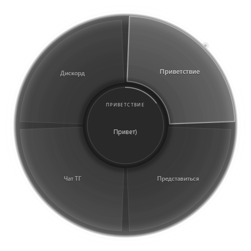
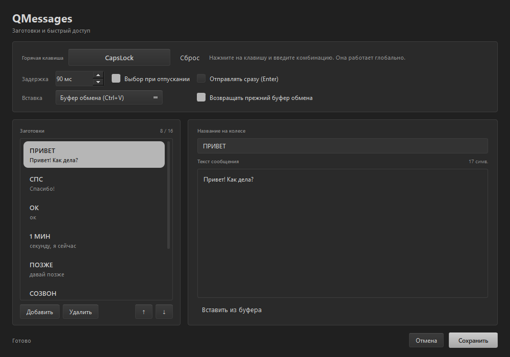

<div align="center">


# QMessages

**Быстрые заготовки для переписки — колесо сообщений под курсором.**

Зажал комбинацию → выбрал сообщение → отпустил — текст уже в чате.

**Русский** · [English](README.en.md)


<br>


<br><sub>Колесо заготовок: удерживай бинд, наведи на сообщение, отпусти.</sub>

</div>

---

## Как это появилось

Каждый день в переписке повторяется одно и то же: приветствие, ссылка, «секунду,
я сейчас», «спасибо». Открывать блокнот и искать шаблон каждый раз — долго и лениво.

Хотелось сделать одно движение: зажал клавишу, выбрал сообщение, отпустил — и
текст уже в поле ввода. Так появилось колесо, как в играх, только для обычных чатов.

QMessages вырос из той же идеи, что и QTranslate-R: маленький локальный инструмент,
который решает одну задачу и не мешает. Никакой телеметрии, аккаунтов и облака —
только заготовки, глобальный хоткей и аккуратный интерфейс в стиле **Metal**.

---

## Что умеет

### Колесо

| | |
|---|---|
| **Вызов удержанием** | Зажал бинд — колесо появилось прямо под курсором. |
| **Выбор движением** | Навёл на сектор и отпустил бинд. Или кликнул ЛКМ. |
| **Отмена** | ПКМ, Esc, отпускание над центром или увод курсора далеко от колеса. |
| **Плавность** | Анимация на 60 fps, мягкая подсветка сектора и превью текста в центре. |
| **Компактность** | Окно 500 px, текст не уменьшается — подписи и превью остаются читаемыми. |

### Заготовки

| | |
|---|---|
| **До 16 сообщений** | Короткая подпись на колесе и полный текст для вставки. |
| **Редактор** | Добавить, удалить, поднять/опустить, изменить подпись и текст. |
| **Автоподпись** | Если подпись пустая — берётся начало текста. |
| **Из буфера** | Кнопка «Вставить из буфера» в редакторе и отдельный пункт в трее. |
| **Сохранение** | Всё хранится в `%APPDATA%\QMessages\config.json`, ничего не теряется. |

### Вставка

| | |
|---|---|
| **Через буфер** | Ctrl+V в активное окно. Лучшая совместимость с чатами и браузером. |
| **Посимвольно** | Режим `type` — если приложение блокирует вставку из буфера. |
| **Сразу отправить** | Галочка «Отправлять сразу (Enter)» нажимает Enter после вставки. |
| **Вернуть буфер** | Прежнее содержимое буфера обмена восстанавливается после вставки. |
| **Без Enter по умолчанию** | Можно проверить текст перед отправкой. |

### Интерфейс и система

- **Metal**: тёмно-серая палитра, градиентные кнопки с фаской, аккуратные поля и список заготовок.
- **Трей**: «Показать колесо», «Сохранить из буфера», «Настройки…», открыть конфиг, перезагрузка.
- **Настройки**: отдельное окно, пока оно открыто — глобальный бинд не перехватывается.
- **Портативность**: exe и все библиотеки лежат в одной папке, установка не нужна.
- **Иконка Qm**: exe, трей, окно настроек, панель задач и Диспетчер задач.

### Что запоминается

Всё, что ты меняешь, сохраняется и переживает перезапуск: горячая клавиша,
заготовки, задержка удержания, выбор при отпускании, способ вставки, отправка
по Enter и возврат буфера обмена.

---

## Установка и запуск

### Портативная сборка

```bat
build.bat
```

Готовое приложение появится в `dist\QMessages`. Папку можно переносить на другой
компьютер или диск: Python, Qt и библиотеки уже внутри, устанавливать ничего не нужно.

Настройки хранятся в `%APPDATA%\QMessages\config.json` и не лежат рядом с exe.
На новом устройстве приложение создаст настройки по умолчанию; чтобы перенести
свои — скопируй этот файл.

В репозиторий папка `dist` не коммитится, поэтому готового exe в исходниках нет.

### Из исходников

Нужен **Python 3.11+**.

```powershell
git clone https://github.com/Awaynos/QMessages.git
cd QMessages
setup.bat
start.bat
```

`setup.bat` создаёт `.venv` и ставит зависимости. `start.bat` запускает без консоли,
`run.bat` — с консолью для отладки.

---

## Горячие клавиши по умолчанию

| Клавиши | Действие |
|---|---|
| `CapsLock` | Открыть колесо (удержание) |
| `ЛКМ` | Выбрать сектор под курсором |
| `ПКМ` / `Esc` | Закрыть без вставки |
| `Mouse4` / `Mouse5` | Можно назначить в настройках |

Все комбинации меняются в **Настройки → Горячая клавиша**. Можно записать
`Ctrl+Alt+Space`, `Alt+\``, `Ctrl+Shift+S`, `F8` или боковую кнопку мыши.

Комбинация перехватывается глобально: пока приложение запущено, эта клавиша
не доходит до других программ. Не назначай `Ctrl+C`, `Ctrl+V` и другие частые
сочетания — они перестанут работать.

---

## Настройки

<div align="center">

<br><sub>Настройки: горячая клавиша, заготовки, поведение и сохранение.</sub>
</div>

- **Горячая клавиша** — нажми на поле и введи комбинацию; «Сброс» возвращает CapsLock.
- **Заготовки** — список слева, редактор справа. Можно менять подпись и текст.
- **Поведение** — задержка удержания, выбор при отпускании, отправка по Enter,
  способ вставки, возврат прежнего буфера.
- **Сохранить** — кнопка внизу или `Ctrl+S`.

Пока окно настроек открыто, глобальная комбинация не перехватывается — можно
спокойно печатать. После закрытия она включается снова.

---

## Быстрое сохранение

1. Скопируй текст.
2. Иконка в трее → **«Сохранить из буфера»**.
3. Поправь название на колесе — оно подставится автоматически.
4. `Ctrl+S`.

Можно и через редактор: «Добавить» → «Вставить из буфера» → «Сохранить».

---

## Конфиг

Файл: `%APPDATA%\QMessages\config.json`. При первом запуске создаётся автоматически.

```json
{
  "hotkey": "caps_lock",
  "hold_delay_ms": 90,
  "select_on_release": true,
  "press_enter": false,
  "paste_method": "clipboard",
  "restore_clipboard": true,
  "restore_delay_ms": 800,
  "snippets": [
    {"label": "ПРИВЕТ", "text": "Привет! Как дела?"}
  ]
}
```

- `hold_delay_ms` — сколько держать бинд до появления колеса, 0–1000 мс.
- `select_on_release` — `true`: выбор при отпускании; `false`: только клик ЛКМ.
- `press_enter` — нажимать Enter после вставки.
- `paste_method` — `clipboard` (Ctrl+V) или `type` (посимвольный ввод).
- `restore_clipboard` — вернуть прежнее содержимое буфера обмена.
- `snippets` — до 16 заготовок; `label` — подпись на колесе, `text` — что вставить.

Палитра интерфейса фиксированная — **Metal** (тёмно-серая), темы не настраиваются.
Файл читается на лету: сохранил — приложение подхватило. Если менял вручную,
нажми «Перезагрузить настройки» в трее.

---

## Структура проекта

```
QMessages/
  main.py            приложение, трей, связка модулей
  settings.py        окно настроек и редактор заготовок
  wheel.py           радиальное меню и анимация
  hotkeys.py         глобальный хук клавиатуры и мыши
  winapi.py          Win32: хуки, SendInput, оверлейное окно
  paste.py           вставка через буфер или посимвольно
  config.py          config.json в %APPDATA%\QMessages
  theme.py           палитра Metal и стили
  icon.ico / icon.png
  VERSION.txt
  file_version_info.txt
  build.bat / setup.bat / start.bat / run.bat
  docs/images/       скриншоты для README
```

---

## Технологии

| | |
|---|---|
| Язык | Python 3.11 |
| Интерфейс | PySide6 / Qt 6 (Essentials: QtCore, QtGui, QtWidgets) |
| Windows | Win32 через `ctypes`: низкоуровневые хуки, SendInput, layered overlay |
| Сборка | PyInstaller, onedir — без установки на целевой машине |
| Сеть | не используется |

Заготовки, горячие клавиши и буфер обмена работают локально. Аккаунт, облако
и телеметрия не нужны.

---

## Что дальше

- [ ] Импорт и экспорт заготовок
- [ ] Профили под разные чаты и приложения
- [ ] Поиск по заготовкам
- [ ] Автозапуск с Windows
- [ ] Отдельная горячая клавиша «сохранить из буфера»
- [ ] Настройка размера колеса
- [ ] Английская локализация интерфейса

---

## Версия и лицензия

**1.0** — стабильная портативная версия. Версия лежит в [`VERSION.txt`](VERSION.txt)
и правится обычным блокнотом.

Проект распространяется под лицензией **[PolyForm Noncommercial 1.0.0](LICENSE)**
([русский перевод](LICENSE.ru.md)) — это *source-available*, а не open source.

Лицензия выбрана осознанно: она запрещает зарабатывать на проекте. Мне важно,
чтобы любой мог свободно форкнуть, изучить и доработать QMessages — но чтобы
никто не превращал его в платный продукт. Коммерческое использование возможно
только по отдельному разрешению автора.
